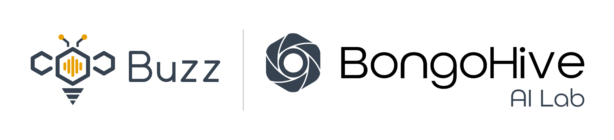

<p align="center"></p>

# Buzz: BongoHive AI voice agents

A self-hosted AI voice-agent platform that answers and places phone calls. It uses local open-source models only: call audio, transcripts and prompts stay on BongoHive infrastructure.

**Status:** base code built and tested offline; waiting for servers to start staging tests. See [docs/PLAN.md](docs/PLAN.md) and [docs/TESTING.md](docs/TESTING.md).

Run every offline test suite with `pip install -r requirements-ci.txt && scripts/test-all.sh`.

## Architecture

```
Caller ─ SIP trunk ─ Asterisk 22 ──ARI + chan_websocket──▶ Dograh (orchestration, UI, API)
                                                             │
                     Web widget / Test Audio ──WebRTC──────▶ │
                                                             ├─▶ vLLM     (Qwen2.5-7B-Instruct-AWQ)
                                                             ├─▶ Speaches (faster-whisper large-v3-turbo, Kokoro)
                                                             └─▶ webhook ─▶ n8n ─▶ HubSpot / Google Sheets
```

## Layout

| Path | Contents |
|---|---|
| `infra/inference` | vLLM + Speaches compose |
| `infra/app` | Dograh compose, nginx/TLS |
| `infra/asterisk` | Asterisk config templates |
| `infra/monitoring` | Prometheus, Grafana, alerts |
| `infra/backup` | Encrypted backups, restore drill, 90-day retention |
| `infra/firewall` | Default-deny egress and inbound allow-lists for both hosts |
| `agents/` | Workflow exports, prompts, test scenarios |
| `integrations/` | n8n flows, webhook schemas, suppression-list service |
| `knowledge_base/` | Cleaned source documents |
| `tests/` | Workflow linter, scenarios, egress capture, latency benchmark |
| `tools/dograh` | Sets up Dograh's local providers and telephony through its API |
| `scripts/` | `test-all.sh` |
| `docs/` | Plan, interfaces, testing plan, decisions, changelog |
| `branding/` | Buzz logos (`svg/` masters, `png/` exports), the Buzz × BongoHive AI Lab co-brand lockup, and `build_logos.py` to regenerate them. Old marks are in `legacy/`. |

Secrets live only in git-ignored `.env` files; each has a committed `.env.example`.
